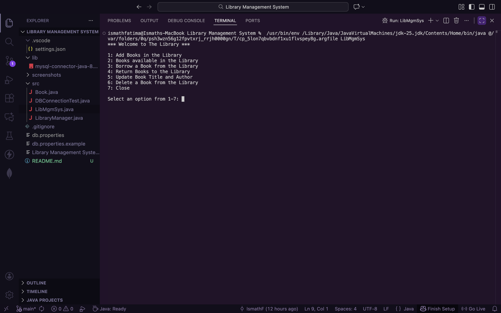
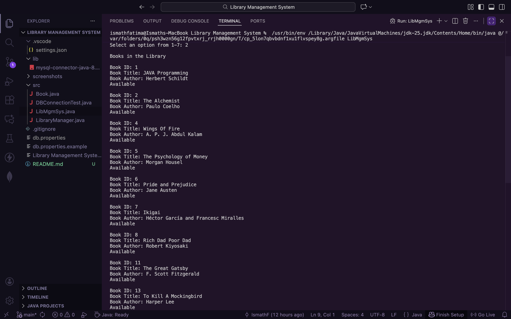
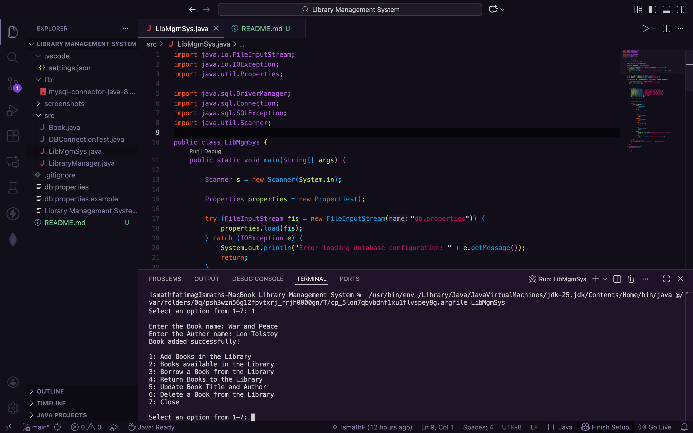
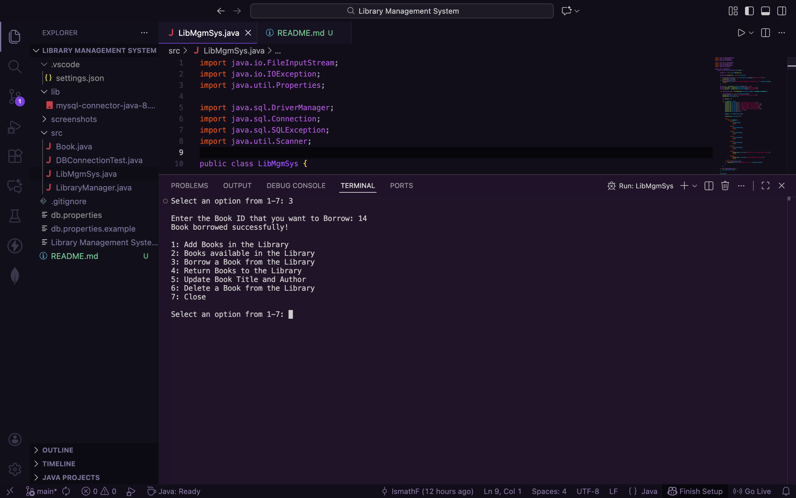
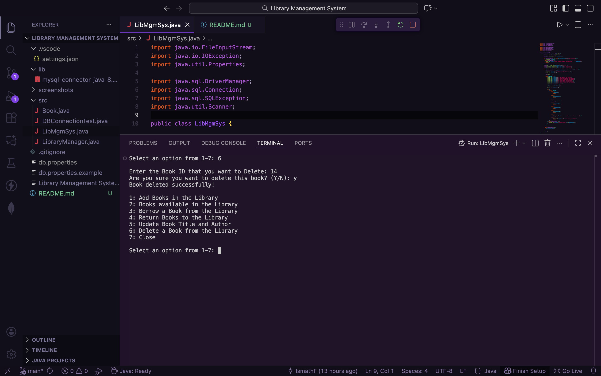
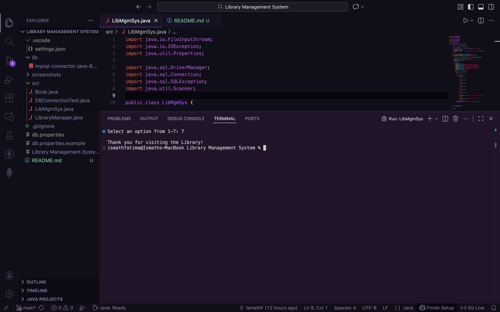

# 📚 Library Management System

A console-based Library Management System developed using **Java, JDBC, and MySQL**.

This application allows users to manage books in a library through a menu-driven interface. It supports adding, displaying, borrowing, returning, updating, and deleting books.

The application uses **JDBC (Java Database Connectivity)** to interact with a MySQL database, ensuring that book records are stored and managed persistently.

# ✨ Features

- **Add Books:** Add new books to the library.
- **Display Books:** View all books stored in the database along with their availability.
- **Borrow Books:** Borrow books from the library.
- **Return Books:** Return borrowed books and update their availability.
- **Update Books:** Modify book titles and authors.
- **Delete Books:** Remove books from the library with confirmation.
- **Input Validation:** Validate user inputs to prevent invalid entries.
- **Exception Handling:** Handle database and input-related errors.

# 🛠️ Technologies Used

- **Java** – Core application logic and object-oriented programming.
- **JDBC** – Database connectivity.
- **MySQL** – Relational database management.
- **MySQL Connector/J 8.0.28** – JDBC driver.
- **VS Code** – Development environment.
- **Git & GitHub** – Version control and project hosting.

## 📁 Project Structure

```
Library-Management-System/
│
├── lib/
│   └── mysql-connector-java-8.0.28.jar
│
├── src/
│   ├── Book.java
│   ├── LibraryManager.java
│   ├── LibMgmSys.java
│   └── DBConnectionTest.java
│
├── .gitignore
├── db.properties.example
├── README.md
└── Library Management System - Original Version.txt
```

## File Description

- **Book.java:** Represents a book and stores its attributes.
- **LibraryManager.java:** Handles library operations such as adding, displaying, borrowing, returning, updating and deleting books.
- **LibMgmSys.java:** Contains the main method, menu-driven interface and database connection.
- **DBConnectionTest.java:** Used to test the database connection.
- **lib/:** Contains the MySQL JDBC connector.
- **db.properties.example:** Provides a sample database configuration.
- **.gitignore:** Specifies files and directories Git should ignore.

## 🗄️ Database Setup

This project uses MySQL to store and manage book records.

### 1. Create the Database

Open MySQL Workbench and execute:

```sql
CREATE DATABASE library_db;
USE library_db;
```

### 2. Create the Books Table

Execute the following SQL query:

```sql
CREATE TABLE books (
    id INT PRIMARY KEY AUTO_INCREMENT,
    title VARCHAR(250) NOT NULL,
    author VARCHAR(250) NOT NULL,
    status TINYINT(1) NOT NULL DEFAULT 1
);
```

### 3. Verify the Table

To verify the table structure, execute:

```sql
DESCRIBE books;
```

The `books` table contains the following columns:

| Column | Data Type | Description |
|---|---|---|
| id | INT | Unique book ID (Primary Key) |
| title | VARCHAR(250) | Book title |
| author | VARCHAR(250) | Book author |
| status | TINYINT(1) | Book availability status |

**Note:** A status value of `1` represents an available book, while `0` represents a borrowed book.

## 🔐 JDBC Configuration

The application uses JDBC to establish a connection between Java and the MySQL database.

Database credentials are stored separately in a `db.properties` file instead of being hardcoded in the Java source code.

### 1. Create the Configuration File

Copy the provided `db.properties.example` file and rename the copy to:

`db.properties`

### 2. Update Database Credentials

Open `db.properties` and enter your MySQL credentials:

```properties
db.url=jdbc:mysql://localhost:3306/library_db
db.username=root
db.password=your_mysql_password
```

Replace the username and password with your own MySQL credentials.

### 3. Security

- Never upload your actual `db.properties` file to GitHub.
- The `.gitignore` file excludes `db.properties` from version control.
- The `db.properties.example` file contains placeholder values for reference.

The application reads these configuration values using Java's `Properties` class and establishes the database connection using JDBC.

## ▶️ How to Run the Application

### Prerequisites

Make sure you have the following installed:

- Java JDK
- MySQL Server
- MySQL Workbench (optional, for database management)

### 1. Clone the Repository

Open your terminal and execute:

```bash
git clone https://github.com/IsmathF/Library-Management-System.git
```

Navigate into the project directory:

```bash
cd Library-Management-System
```

### 2. Configure the Database

Follow the [Database Setup](#-database-setup) instructions to create the database and books table.

### 3. Configure JDBC Credentials

Copy `db.properties.example` and rename the copy to `db.properties`.

Update the file with your own MySQL username and password.

### 4. Compile the Java Files

From the project root directory, execute:

```bash
mkdir -p out

javac -cp "lib/mysql-connector-java-8.0.28.jar" -d out src/*.java
```

### 5. Run the Application

Execute:

```bash
java -cp "out:lib/mysql-connector-java-8.0.28.jar" LibMgmSys
```

The Library Management System menu will appear in your terminal.

**Note:** The commands above use the classpath separator for macOS and Linux. On Windows, replace `:` with `;` in the Java run command.

## 📸 Application Screenshots

### Main Menu


### Displaying Books


### Adding a Book


### Borrowing Books


### Returning Books


### Updating Books


### Deleting Books


### Exit



